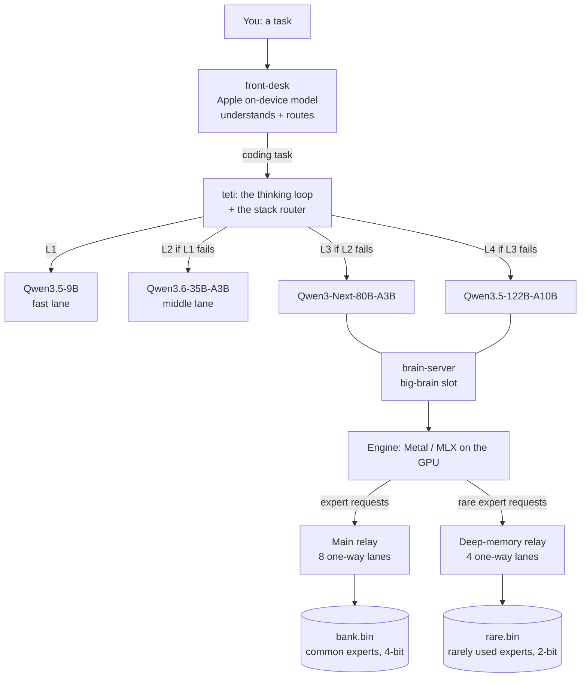
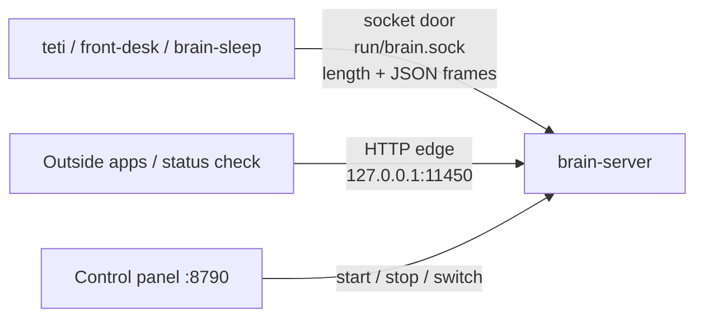
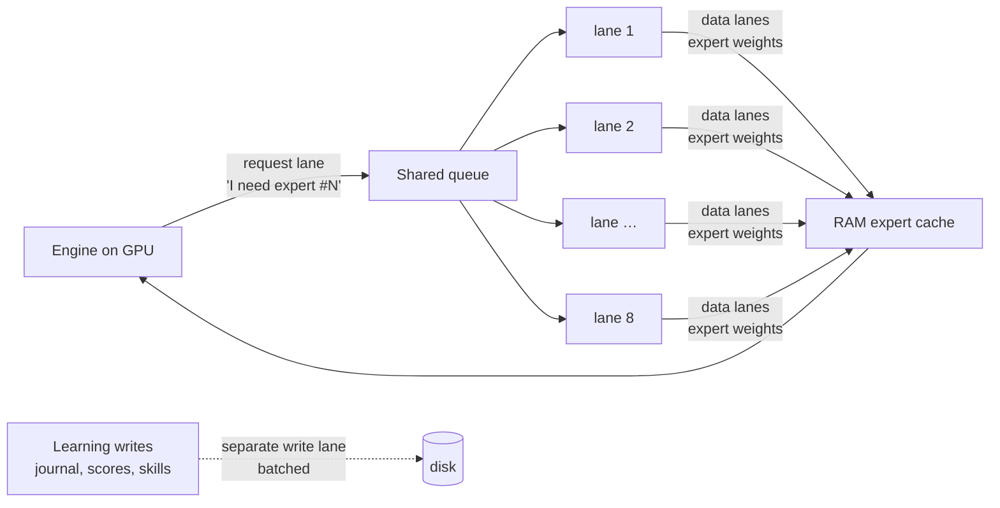
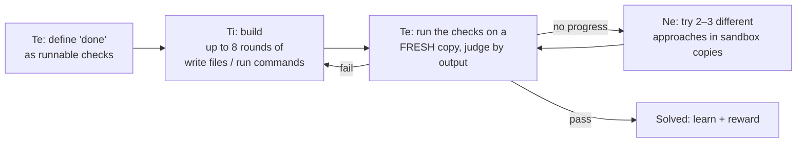

<p><a href="README.md">🏠 Home</a> · <a href="LEARNING.md">🧭 How I learned</a> · <a href="PROGRESS.md">📈 Progress</a> · <b>🔧 Architecture</b> · <a href="HOW-ITS-BUILT.md">🤝 How it's built</a> · <a href="../../discussions">💬 Discussions</a></p>

# Architecture: how every piece fits together

*⏱ 20-minute read*

<!-- toc:start -->
> **In short:** How every piece fits together, in enough detail to rebuild it: the four-layer stack, the Swift servers and their ports, the one-way lanes and two relays that stream experts from the SSD, the three routers, the files on disk, memory management, the thinking loop and overnight sleep.

**Contents**
- [1. The big picture](#1-the-big-picture): One diagram: a task climbs 9B → 35B → 80B → 122B; the top two stream from the SSD through two relays.
- [2. The machine it's built for](#2-the-machine-its-built-for): M1 Pro, 32 GB, measured SSD speeds, and the math showing the RAM cache hit rate decides speed.
- [3. Before and after the Swift conversion](#3-before-and-after-the-swift-conversion): Every piece, before vs after going all-Swift; the 9B went 15.5 → 32.5 tok/s (with caveats).
- [4. The programs](#4-the-programs): 4 shared libraries and 8 programs: server, thinking loop, front desk, layout, shrink, sleep, tests.
- [5. Servers, ports and connections](#5-servers-ports-and-connections): Every port and socket, why each layer gets its own server, and the 4-byte-length + JSON wire format.
- [6. One-way routing: lanes and relays](#6-one-way-routing-lanes-and-relays): One-way request and data lanes, a file handle per lane, least-resistance routing; 8 lanes = 8.5 GB/s.
- [7. The three routers](#7-the-three-routers): The model's expert router (with prefetch), the stack router between layers, and the front desk.
- [8. What happens for one word](#8-what-happens-for-one-word): 48 layers, cache hit vs SSD miss, draft-model guessing (+24%), and prompt memory.
- [9. The brain on disk](#9-the-brain-on-disk): hot weights 3.2 GB in RAM, 61 GB expert bank in 16 KB-aligned blocks, index files, deep memory.
- [10. Memory: RAM is conscious, SSD is subconscious](#10-memory-ram-is-conscious-ssd-is-subconscious): How the expert cache sizes, fills, evicts and survives memory pressure without freezing.
- [11. The thinking loop](#11-the-thinking-loop): Te defines done, Ti builds, Ne tries new paths; memory, points, sandbox and the hidden exam.
- [12. Sleep: overnight maintenance](#12-sleep-overnight-maintenance): 7 phases: clean up memory, repair, practice, train only if it helps, shrink, report.
- [13. Settings](#13-settings): The 6 switches: cache size, prefetch, draft model, usage counting, 2-bit conversion.
- [14. Rebuild it step by step](#14-rebuild-it-step-by-step): 10 commands from build to serving, tasks, the full stack, shrinking and measuring.
- [15. Known gaps](#15-known-gaps): What isn't done or proven yet, stated plainly.
<!-- toc:end -->

This is the full technical walkthrough of how Code Smash TeTi is set up: every program, server, port, connection, file
and setting, and why each one is the way it is. It's written so someone else could rebuild the same setup. For the
story of how it got here, see [PROGRESS.md](PROGRESS.md). For who does what, see [HOW-ITS-BUILT.md](HOW-ITS-BUILT.md).

> The code is published when the project reaches its finish line. The commands below are the ones that will ship.


---

## 1. The big picture

A task enters at the bottom of a four-layer stack and climbs only when it fails its checks. The top two layers are too
big for RAM, so they run in my own Swift server, which streams their experts from the SSD through two relays.



Each layer only exists because the one below it can't do everything:

| Layer | Model | Where it runs | Speed here | Role |
|---|---|---|---|---|
| L1 | Qwen3.5-9B | in RAM | 15.5 tok/s (Python, 16-bit) · 32.5 tok/s (Swift, 4-bit) | quick tasks |
| L2 | Qwen3.6-35B-A3B | in RAM | ~53 tok/s | everyday coding |
| L3 | Qwen3-Next-80B-A3B | streamed from SSD | ~2.1 tok/s | hard tasks |
| L4 | Qwen3.5-122B-A10B | streamed from SSD | ~1.5 tok/s | last resort |

---

## 2. The machine it's built for

Everything is tuned for one laptop. These numbers drove the design.

| Part | Spec | Measured |
|---|---|---|
| Chip | M1 Pro: 8 performance + 2 efficiency cores, 16-core GPU, 16-core Neural Engine | |
| Memory | 32 GB unified (CPU and GPU share it) | ~200 GB/s |
| Internal SSD | NVMe | 3.48 GB/s on 1 lane → 5.51 GB/s on 4 lanes (uncached) |
| External SSD | USB | 0.81 → 0.90 GB/s (capped by USB) |

**The math that decided everything:** at 4-bit, ~5 GB of expert weights are touched per token. If 10% miss the RAM
cache, SSD reads cap speed near ~12 tok/s; at 30% misses, ~4 tok/s. So **the RAM cache hit rate decides speed.** The
brain's experts live on the **internal** SSD (the fast one). The external drive holds downloads and backups. Flash
drives and network drives were measured as too slow to help.

**Which chip does what:**
- **GPU:** attention and the experts (the heavy math), through Metal via MLX
- **CPU:** the SSD relays, prefetching, tokenizing and control
- **Neural Engine:** Apple's on-device language model for the front desk

---

## 3. Before and after the Swift conversion

**The rule:** every part in one language, so every part talks the same way. "Every part needs to be the same for the
best communication." Apple's native languages are Swift for code and Metal for the GPU, so everything that reads, runs,
shrinks or trains the model is Swift + Metal. The weights themselves are just data files.

| Piece | Before | After |
|---|---|---|
| Inference server | Python servers (MLX for Python, Ollama) | `brain-server`, Swift on [mlx-swift-lm](https://github.com/ml-explore/mlx-swift-lm) |
| Talking between parts | HTTP + JSON between separate programs | One shared Swift package (`BrainCore`) defines every message type once; parts talk as Swift actors in one process, or over Unix sockets between processes; HTTP only at the outside edge |
| Doing many things at once | Python's global lock limits real parallel work | Swift structured concurrency: each "organ" (relay lanes, prefetcher, GPU decoder, memory keeper) is its own `actor` running in parallel |
| Test bench | Python scripts | `bench-swift` (Swift); the Python one is retired |
| Model download | Python Hugging Face downloader (stalled at 0 bytes) | Swift `fetch` tool, and parallel resumable `curl` |
| Laying the model on disk | none (models loaded as downloaded) | `lay`, Swift: rewrites the model into the brain's own layout (§9) |
| Shrinking, profiling, exams | none | `prune`, Swift (§14) |
| Overnight training | Python LoRA scripts | `brain-sleep`, Swift LoRA via mlx-swift-lm |

**Measured difference, same 9B model, same Mac:**

| | Engine | Precision | Speed | One real task |
|---|---|---|---|---|
| Before | Python + MTP speculative decoding | 16-bit | 15.5 tok/s | ✅ passed in 52 s |
| After | Swift `brain-server` | 4-bit | **32.5 tok/s (2.1×)** | ❌ misread the task |

That isn't a pure language comparison: the Swift copy is 4-bit and the Python one is 16-bit, and one task is one sample.
The speed gain is real; whether 4-bit costs quality is still being tested.

---

## 4. The programs

One Swift package, `brain/`, holds four libraries and eight programs.

**Libraries**

| Module | Job |
|---|---|
| `BrainCore` | The shared language: message types, the socket wire format, relay protocol, paths. Every program imports it. |
| `BrainEngine` | The inference engine: loading, expert streaming, the expert cache, both relays, prompt memory, speculative decoding |
| `BrainMind` | The thinking loop (Te/Ti/Ne), working memory (Si), knowledge bank (Ni), track record, sandbox, clients for every server |
| `BrainBench` | The test bench (in `bench-swift/`) |

**Programs**

| Program | What it does |
|---|---|
| `brain-server` | Loads a brain and serves it on a socket and a local HTTP port |
| `teti` | Runs a task through the thinking loop, and walks the four-layer stack (`--lane auto`) |
| `front-desk` | Apple's on-device model reads your message and routes it: coding task, question or Mac action |
| `lay` | Rewrites a downloaded model into the brain's on-disk layout and verifies it byte for byte |
| `prune` | Profiles expert usage on your code, plans and applies shrinks, runs exams and speed tests |
| `brain-sleep` | Overnight maintenance: memory cleanup, repair, practice, training, shrinking |
| `brain-relay` | Stand-alone relay used to measure lanes (the engine has the relay built in) |
| `expert-test` | Exactness and stress tests for the streaming layer |

Plus a small **control panel** (`panel/`, local web page) to start, stop and switch brains, and watch exams.

---

## 5. Servers, ports and connections

**Everything listens on 127.0.0.1 only.** Nothing is reachable from outside the Mac.

| Port / socket | Who | What travels on it |
|---|---|---|
| `run/brain.sock` | `brain-server`, big-brain slot (L3/L4) | The **socket door**: how my own programs talk to the brain. Fastest path. |
| `127.0.0.1:11450` | same `brain-server` | The **HTTP edge**, Ollama-compatible (`/api/chat`, `/api/tags`, `/health`) for outside apps and the status check |
| `run/fast.sock` + `:11451` | a second `brain-server` (`--port 11451 --socket run/fast.sock`) | L1: the 9B in the Swift engine |
| `run/mid.sock` + `:11453` | a third `brain-server` | L2: the 35B in the Swift engine (being raced against Ollama) |
| `:11440` | Python MTP server | L1, the original 9B path (16-bit + speculative decoding) |
| `:11435` | Ollama | L2 today |
| `:8790` | control panel | Start/stop/switch brains, exams, sleep. Changes need an `X-Panel` header. |

**Why multiple servers:** each layer gets its own process, port and socket, so one layer loading or working never blocks
another. The big-brain slot is shared by L3 and L4 because they can't both fit in RAM: `teti` frees the light layers'
memory, asks the panel to swap brains, and waits until `/health` reports the right model.

**The socket door's wire format:** each message is a **4-byte big-endian length** followed by that many bytes of JSON.
Generated tokens stream back the same way. The socket file is owner-only. Programs prefer the socket and fall back to a
stand-in model if the real brain isn't up.



---

## 6. One-way routing: lanes and relays

**The design rule:** every path carries information in **one direction only**, so no part stops and waits for traffic
coming the other way, like one-way streets instead of a single door.



- **Request lanes (engine → relay):** tiny "I need expert #N" messages.
- **Data lanes (relay → engine):** expert weights flow back on separate lanes. **Each lane has its own file handle and
  buffer**, so lanes never wait on each other.
- **Path of least resistance:** each request goes to the lane with the shortest expected wait, based on each lane's
  measured speed. An idle lane steals queued work from the most backed-up one.
- **Reads and writes never share a lane.** The expert files are read-only while thinking. Learning writes (journal,
  knowledge scores, new skills) go on their own lane in batches.
- **Pipelining:** while layer L computes on the GPU, the lanes are already fetching what layer L+1 will probably need.
- **Direct reads:** each lane opens the file with the OS cache off (`F_NOCACHE`), and every expert is aligned to 16 KB SSD
  pages, so one expert is exactly one direct read.
- **Every delivery is checked** against the block it was supposed to be.

**Measured, random 5.25 MB expert reads, 32 in flight, internal SSD:**

| Lanes | Throughput | Avg wait | p95 wait |
|---|---|---|---|
| 1 | 2.79 GB/s | 61.7 ms | 64.5 ms |
| 2 | 4.90 GB/s | 34.5 ms | 37.2 ms |
| 4 | 6.63 GB/s | 25.0 ms | 36.0 ms |
| **8 (default)** | **8.51 GB/s** | **18.1 ms** | **28.6 ms** |
| 12 | 9.43 GB/s | 11.7 ms | 22.8 ms |

8 is the default: 12 adds little.

**Two relays.** Rarely used experts ("deep memory") live in a separate file, `rare.bin`, served by a **second relay with
its own 4 lanes and its own file handles**, so a rare fetch can never block the common experts' 8 lanes. Both relays
read at the same time. If a rare expert starts getting used a lot, the next shrink plan promotes it back.

---

## 7. The three routers

"Routing" happens at three levels.

**1. Inside the model: the expert router (per word, per layer).** A mixture-of-experts model has a small router in each
layer that picks ~10 experts out of hundreds for each word. My streaming layer (`StreamingSwitchGLU`) replaces the
model's normal expert layer: it reads the router's picks, fetches only those experts (cache, else relay), and runs
Apple's `gatherQuantizedMM` on just them.
- **Prefetch ("what if"):** while layer L computes, layer L+1's own router is run early on L's output, and its top
  guesses start loading in the background. The number of guesses is budgeted to the GPU's time window × SSD speed, so
  guessing never floods the lanes. If fewer than half of guesses get used, guessing rests and retries later. It stays on
  only if a race shows it's at least 3% faster (it measured about 5%).
- **Masked router:** if experts are hard-deleted, their router scores are forced to −∞ so they can never be picked.

**2. Between layers of the stack: the stack router (per task).** `teti solve --lane auto` starts the task at L1 and gives
each layer a few rounds (2 / 2 / 3 / the rest). A layer passes only when Te's checks pass. If not, the task moves up,
**in the same project folder**, and the next layer sees the earlier attempts. Layers can be skipped (`--skip fast`).

**3. At the front door: the front desk (per message).** Apple's on-device ~3B model (FoundationModels, on the Neural
Engine) turns your message into a typed intake (kind, precise task, project name) and routes it: coding → the thinking
loop; question → the brain; Mac action → Apple's model with a small allowlist of Shortcuts. Until Apple's model is ready
on the Mac, a built-in keyword reader does the routing.

---

## 8. What happens for one word

On a streamed brain (L3/L4), producing one word goes like this:

1. **Hot weights are always in RAM:** attention, routers, shared experts and norms (~3.2 GB for the 122B).
2. For each of the 48 layers:
   1. Attention runs on the GPU.
   2. The layer's router picks its experts for this word.
   3. Each pick is looked up in the RAM cache. **Hit:** used directly (~0.001 ms). **Miss:** requested on a lane
      (~10 ms cold from SSD for a batch of 8).
   4. Meanwhile the prefetcher has already guessed and started loading layer L+1's likely experts.
   5. The picked experts run on the GPU and their outputs are combined.
3. With **speculative decoding**, a small draft model first guesses 3 words. The big model checks all of them in one
   pass, keeps the ones it agrees with plus its own next word, and restores a saved cache copy where it disagrees.
   (Measured on the 122B: 2.28 → 2.84 tok/s, 88% of guesses accepted.)
4. **Prompt memory:** the state at message boundaries is saved (up to 8 slots), so a new request that starts with the same
   text skips re-reading it. (17–20× faster second turn on a test model.)

Every expert firing is counted. That count is the evidence for shrinking (§12).

---

## 9. The brain on disk

`lay` turns a downloaded model into this folder (the 122B shown):

| File | Size | What it is |
|---|---|---|
| `hot.safetensors` | 3.2 GB | Everything that isn't an expert. Loaded into RAM at start. |
| `bank.bin` | 61 GB | Every routed expert as its own block: **5,308,416 bytes = exactly 324 × 16 KB pages**, one direct read each |
| `bank.json` | 1.9 MB | The relay's index: expert → offset, size, checksum, strength score |
| `bank-meta.json` | 1.9 MB | Layer/expert map, layout, SHA-256 of every block, bits per block |
| `rare.bin` | varies | Deep memory: rarely used experts, stored at 2 or 3 bits (only in shrunk brains) |
| `draft-model` | link | The small model this brain uses for speculative decoding |
| tokenizer + config files | small | Copied from the download |

- **Experts that fire together are stored side by side** (`lay --order` takes the usage profile), so one read brings in
  neighbors.
- **The vision tower is dropped** (0.9 GB) since this is a coding brain.
- **Verification:** blocks and hot tensors are compared byte for byte against the original before the brain is used.
- A shrunk brain's `rare.bin` starts as a **hard link** to the original bank, so it costs 0 extra bytes until rewritten.

---

## 10. Memory: RAM is conscious, SSD is subconscious

- **Conscious (RAM):** what the brain is thinking with right now: the hot weights, the experts firing for this task, the
  conversation, the project journal.
- **Subconscious (SSD):** everything it knows but isn't using this moment: all other experts, the knowledge bank, past
  journals.
- **The relays are the bridge,** and prefetching is its intuition.
- **Habits form by use:** often-used experts stay in RAM; unused ones sink back to the SSD.

**How the expert cache manages itself:**
- **Size:** set at load to truly free RAM minus a 5 GB reserve (capped at physical RAM − 13 GB, ~21 GB here). It waits up
  to 30 s for free RAM to stop climbing before measuring, so a just-closed program doesn't skew it.
- **Filled most-used first** at startup from the usage counts.
- **Eviction:** least-often-used, with recency breaking ties, so common experts stay.
- **Pressure:** on a macOS memory warning it shrinks 25% (critical: 50%) and hands the RAM back; every 60 s it grows and
  refills when RAM frees up. Warnings have a floor and the temporary ceiling expires, so it can't collapse.
- **Freeing safely:** evicted experts go to a "graveyard" that's released outside the cache's lock. Freeing GPU memory
  inside the lock once deadlocked the whole brain.
- Shrunk (2-bit) experts count as ~0.78 of a slot, so the cache budgets bytes, not just counts.

---

## 11. The thinking loop

`teti` runs every task through roles named after cognitive functions:



- **Te** turns the task into concrete runnable checks that create their own test input, so Ti can't shape the exam.
  **Only Te can declare a task done.** Te may add a missed check, never remove one, and audits its own failing checks first
  ("is my check wrong, or the program?").
- **Ti** builds: writes files and runs commands, up to 8 inner rounds per phase.
- **Ne** ("what if") fires when a loop stops making progress: remembered breakthroughs first, then fresh ideas, each tried
  in its own sandbox copy. The best score wins.
- **Si** (working memory): a project journal (plan, done list, open problems, decisions and why), updated after every check.
- **Ni** (knowledge bank): only lessons that passed real tests get stored, with a strength score that rises with success
  and falls with failure. Hard "NEVER X → INSTEAD Y" rules are shown first.
- **Stakes:** every prompt carries the track record. Points: +10 solved first try, +5 solved, +3 per breakthrough, streak
  bonus; −1 per failed loop, −5 unsolved, **−10 for claiming success while checks fail.** Honest "I can't" isn't punished.
- **Sandbox:** every command runs under macOS `sandbox-exec`: writes only inside the project folder, no network, no package
  installs.
- **Hidden-test exam:** a separate 12-task exam the brain never sees the tests for. A "false win" has its reward thrown out
  so it's never trained on.

---

## 12. Sleep: overnight maintenance

`brain-sleep` runs when the Mac is idle (≥ 45 min), on power, with no brain work running, checked every 30 minutes:

1. **Memory consolidation:** merge duplicate lessons, let unused ones fade, turn 3+ related lessons into one rule
2. **Working-memory tidy:** trim and archive journals
3. **Repair:** checksum samples of the expert bank, disk space, log rotation
4. **Dreaming:** replay unsolved tasks in a sandbox; solves earn rewards
5. **Training:** LoRA (rank 8, last 4 layers, attention + shared expert; never the routers or streamed experts) on
   verified wins. **Adopted only if** held-out loss improves ≥ 1% **and** a fixed 12-question do-no-harm exam doesn't get
   more than 3% worse. Otherwise it's thrown away.
6. **Shrinking:** profile expert usage on my own code (resumes nightly until 200k tokens), then run the shrink ladder:
   try steadily smaller versions and adopt the smallest that passes the held-out exam (+3% loss allowed). Exams run with
   usage counting off, so test code never leaks into the evidence.
7. **Morning report** and a notification.

---

## 13. Settings

| Setting | Effect |
|---|---|
| `TETI_EXPERT_CACHE_GB=<n>` | Pin the expert cache to a fixed size instead of auto |
| `TETI_NO_GUESS=1` | Turn off next-layer prefetch |
| `TETI_NO_DRAFT=1` | Turn off speculative decoding |
| `TETI_DRAFT=<path>` | Use a specific draft model |
| `TETI_NO_USAGE=1` | Don't count expert usage (exams set this) |
| `TETI_RARE_AS4=1` | Convert 2/3-bit experts to 4-bit exactly as they load (being measured) |

---

## 14. Rebuild it step by step

**Needs:** an Apple Silicon Mac, Xcode with the Metal toolchain, Swift 6.x, and roughly 2× the model size in free SSD
space for the layout step.

```bash
# 1. Build everything (release)
cd brain && swift build -c release

# 2. Download a model (example: the 122B, 4-bit, ~70 GB)
#    any resumable downloader works; parallel curl is what I use

# 3. Lay it out for streaming, then verify byte for byte
.build/release/lay build  --source <downloaded-model-dir> --out ../models/code-smash-teti
.build/release/lay verify --source <downloaded-model-dir> --out ../models/code-smash-teti

# 4. Check it loads and writes sensible code
.build/release/prune loadcheck --brain ../models/code-smash-teti

# 5. Serve it (socket door + HTTP edge on 127.0.0.1:11450)
.build/release/brain-server --model ../models/code-smash-teti --name code-smash-teti

# 6. Give it a task
.build/release/teti solve --brain --project demo --dir ../projects/demo \
  --task "Write a Python script vowels.py that prints the number of vowels in its argument."

# 7. Walk the whole stack instead of one brain
.build/release/teti solve --lane auto --project demo --dir ../projects/demo --task "…"

# 8. Shrink it to your own code
.build/release/prune profile --brain ../models/code-smash-teti --tokens 200000 --chunk 4096
.build/release/prune ladder  --brain ../models/code-smash-teti --adopt
#   default steps 0.95:3, 0.90:3, 0.90:2 (keep experts covering 95%/90% of picks at 4-bit, the rest at 3/2-bit);
#   stops at the first exam fail; --adopt makes the winner active only if it also scores at least as well

# 9. Measure
.build/release/prune speed     --brain ../models/code-smash-teti
.build/release/prune codecheck --brain ../models/code-smash-teti
python3 ../exams/run_ladder.py --round my-first-round      # the 12-task hidden-test exam

# 10. A second server for a lighter layer, on its own port and socket
.build/release/brain-server --model ../models/fast/qwen3.5-9b-4bit --name qwen3.5-9b-fast \
  --port 11451 --socket ../run/fast.sock
```

**Other `prune` commands:** `corpus` (build the profiling set from your code, ~10% held out), `plan`, `apply`, `exam`,
`slim` and `slimtest` (mixed-precision shrink and its exactness test), `selftest`.

**Other `lay` options:** `--order <usage profile>` (put co-firing experts side by side), `--keep-vision`,
`--available-only` (lay a partly downloaded model); `verify` also takes `--samples <n>` (how many blocks to check).

---

## 15. Known gaps

Honest list of what isn't done or isn't proven yet:
- The full four-layer stack hasn't run end to end yet.
- The shrunk 122B isn't faster yet; the exact 2-bit → 4-bit conversion is being measured.
- Prompt memory resets whenever the thinking loop changes phase (the journal sat in the system prompt). Fix written, goes
  in after the current exam.
- The Swift 4-bit 9B failed its one real task; unclear whether it's 4-bit, Swift, or luck.
- Overnight training is proven on a small model, not yet at full scale on the 122B.
- Apple's on-device model wasn't ready on this Mac yet, so the front desk uses its keyword router.

---
<p><b>Next →</b> <a href="HOW-ITS-BUILT.md">🤝 How it's built</a> (4 min) · <a href="README.md">🏠 back to Home</a> · <a href="../../discussions">💬 questions? Discussions</a></p>
