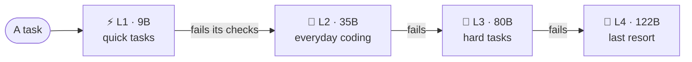

# Code Smash TeTi

**A step-up layered coding brain that stays usable on a 32 GB MacBook.**
Fast small models handle most of the work; only the tasks they can't pass climb to bigger brains, up to a 122B
streamed from the SSD. Native Swift + Metal, built on [MLX](https://github.com/ml-explore/mlx), all local.

<b>📖 Docs:</b>
<a href="#table-of-contents">Contents</a> ·
<a href="ARCHITECTURE.md">Architecture</a> ·
<a href="PROGRESS.md">Progress</a> ·
<a href="LEARNING.md">How I learned</a> ·
<a href="HOW-ITS-BUILT.md">How it's built</a> ·
<a href="../../discussions">💬 Discussions</a> ·
<a href="https://nightguard-labs.github.io">🌐 Live build log</a>

| 🧩 The problem | ⚡ The idea | 📏 The goal |
|---|---|---|
| The 122B is **64 GB**. The Mac has **32 GB** and can't be upgraded. | Stream the big models from the SSD, and put fast small models in front so most tasks never need them. | **Usable:** quick answers in seconds, small tasks **under 10 minutes**. (It started at ~40.) |

> 🚧 **Code coming soon.** It goes public when it reaches the finish line: 10 of 12 on a hidden-test exam with zero
> false wins, and small tasks done in under 10 minutes. ⭐ Star or 👁 watch to follow along.

<!-- toc:start -->
## Table of contents
Every document, what it covers, and each section in one line. Click a section to jump straight to it.

### 🔧 [Architecture](ARCHITECTURE.md) · 20 min
How every piece fits together, in enough detail to rebuild it: the four-layer stack, the Swift servers and their ports, the one-way lanes and two relays that stream experts from the SSD, the three routers, the files on disk, memory management, the thinking loop and overnight sleep.

Sections

- [1. The big picture](ARCHITECTURE.md#1-the-big-picture): One diagram: a task climbs 9B → 35B → 80B → 122B; the top two stream from the SSD through two relays.
- [2. The machine it's built for](ARCHITECTURE.md#2-the-machine-its-built-for): M1 Pro, 32 GB, measured SSD speeds, and the math showing the RAM cache hit rate decides speed.
- [3. Before and after the Swift conversion](ARCHITECTURE.md#3-before-and-after-the-swift-conversion): Every piece, before vs after going all-Swift; the 9B went 15.5 → 32.5 tok/s (with caveats).
- [4. The programs](ARCHITECTURE.md#4-the-programs): 4 shared libraries and 8 programs: server, thinking loop, front desk, layout, shrink, sleep, tests.
- [5. Servers, ports and connections](ARCHITECTURE.md#5-servers-ports-and-connections): Every port and socket, why each layer gets its own server, and the 4-byte-length + JSON wire format.
- [6. One-way routing: lanes and relays](ARCHITECTURE.md#6-one-way-routing-lanes-and-relays): One-way request and data lanes, a file handle per lane, least-resistance routing; 8 lanes = 8.5 GB/s.
- [7. The three routers](ARCHITECTURE.md#7-the-three-routers): The model's expert router (with prefetch), the stack router between layers, and the front desk.
- [8. What happens for one word](ARCHITECTURE.md#8-what-happens-for-one-word): 48 layers, cache hit vs SSD miss, draft-model guessing (+24%), and prompt memory.
- [9. The brain on disk](ARCHITECTURE.md#9-the-brain-on-disk): hot weights 3.2 GB in RAM, 61 GB expert bank in 16 KB-aligned blocks, index files, deep memory.
- [10. Memory: RAM is conscious, SSD is subconscious](ARCHITECTURE.md#10-memory-ram-is-conscious-ssd-is-subconscious): How the expert cache sizes, fills, evicts and survives memory pressure without freezing.
- [11. The thinking loop](ARCHITECTURE.md#11-the-thinking-loop): Te defines done, Ti builds, Ne tries new paths; memory, points, sandbox and the hidden exam.
- [12. Sleep: overnight maintenance](ARCHITECTURE.md#12-sleep-overnight-maintenance): 7 phases: clean up memory, repair, practice, train only if it helps, shrink, report.
- [13. Settings](ARCHITECTURE.md#13-settings): The 6 switches: cache size, prefetch, draft model, usage counting, 2-bit conversion.
- [14. Rebuild it step by step](ARCHITECTURE.md#14-rebuild-it-step-by-step): 10 commands from build to serving, tasks, the full stack, shrinking and measuring.
- [15. Known gaps](ARCHITECTURE.md#15-known-gaps): What isn't done or proven yet, stated plainly.

### 📈 [Progress](PROGRESS.md) · 10 min
The build history in order: what I tried, what worked, what didn't, and how each problem got fixed, with the real numbers. Ends with the to-do list and the lessons so far.

Sections

- [1. Before this project: low-bit models can't code](PROGRESS.md#1-before-this-project-low-bit-models-cant-code): A 2-bit model couldn't code, so coding experts stay at 3–4 bit.
- [2. Picking the base model](PROGRESS.md#2-picking-the-base-model): Why Qwen3.5-122B-A10B, and the problem: 64 GB on a 32 GB Mac.
- [3. Measuring the hardware before building on it](PROGRESS.md#3-measuring-the-hardware-before-building-on-it): SSD speeds first; the hit-rate math set the whole design.
- [4. The engine: all native Swift + Metal](PROGRESS.md#4-the-engine-all-native-swift--metal): Relay lanes, the disk layout, and streaming that matched the original exactly.
  - [The SSD relay](PROGRESS.md#the-ssd-relay): 1 → 12 lanes measured; 8 chosen.
  - [Laying the model out on disk](PROGRESS.md#laying-the-model-out-on-disk): One expert = one direct read, verified byte for byte.
  - [Streaming the experts](PROGRESS.md#streaming-the-experts): 0.00000 difference vs the in-RAM layer; a self-sizing cache.
- [5. First brain live (Nov 5)](PROGRESS.md#5-first-brain-live-nov-5): The 122B ran at ~3 tok/s; my own speculative decoding added 24%.
- [6. The thinking loop](PROGRESS.md#6-the-thinking-loop): Te/Ti solved real tasks; a broken check and a repeated mistake, both fixed.
- [7. Bugs that taught me something](PROGRESS.md#7-bugs-that-taught-me-something): A deadlock freeze, a collapsing cache, and exam leakage, all fixed.
- [8. Shrinking: the plan changed](PROGRESS.md#8-shrinking-the-plan-changed): Only 11% could be cut, so rare experts went to 2-bit: +0.66% loss, but not faster yet.
- [9. A fair exam](PROGRESS.md#9-a-fair-exam): 12 hidden-test tasks; the 80B matched the 122B at ~3× the speed.
- [10. The speed problem, and the stack](PROGRESS.md#10-the-speed-problem-and-the-stack): 40-minute tasks led to the four-layer stack; Swift doubled the 9B.
- [Still working on](PROGRESS.md#still-working-on): The open checklist.
- [Lessons so far](PROGRESS.md#lessons-so-far): Five takeaways.

### 🧭 [How I learned](LEARNING.md) · 8 min
Two months from zero: I got this Mac in September 2026 with no programming or AI background. Every entry is something I built, broke or figured out, and the rule I made from it.

Sections

- [How I learn](LEARNING.md#how-i-learn): Five habits: find the real cause, turn mistakes into rules, demand proof, measure, write it down.
- [The log](LEARNING.md#the-log): 14 dated entries:
  - [Sep 2026 · Built: Day one: local models and my first assistant](LEARNING.md#sep-2026--built-day-one-local-models-and-my-first-assistant): Local models + an assistant with a hard wall around risky actions.
  - [Sep 2026 · Built: A canary to catch poisoned web pages](LEARNING.md#sep-2026--built-a-canary-to-catch-poisoned-web-pages): A small outside model screens every web page first.
  - [Sep 2026 · Mess-up: My AI took down its own server](LEARNING.md#sep-2026--mess-up-my-ai-took-down-its-own-server): It "fixed" the wrong thing and crashed the server.
  - [Oct 2026 · Mess-up: The watchdog that never barked](LEARNING.md#oct-2026--mess-up-the-watchdog-that-never-barked): A monitor crashed silently for weeks.
  - [Oct 2026 · Mess-up: "Project complete" (it wasn't)](LEARNING.md#oct-2026--mess-up-project-complete-it-wasnt): Broken app, missing lessons, invented functions.
  - [Oct 2026 · Figured out: Enforce it in code, not in the prompt](LEARNING.md#oct-2026--figured-out-enforce-it-in-code-not-in-the-prompt): Auto-escalation when the AI is stuck.
  - [Oct 2026 · Mess-up: A model that didn't know who made it](LEARNING.md#oct-2026--mess-up-a-model-that-didnt-know-who-made-it): Confidence isn't correctness.
  - [Oct 2026 · Figured out: Why my AI kept returning garbage](LEARNING.md#oct-2026--figured-out-why-my-ai-kept-returning-garbage): Memory pressure, root-caused and fixed.
  - [Oct 2026 · Mess-up: The night an AI agent erased my models](LEARNING.md#oct-2026--mess-up-the-night-an-ai-agent-erased-my-models): Permission for one thing isn't permission for everything.
  - [Oct 2026 · Mess-up: Agents left alone write broken code](LEARNING.md#oct-2026--mess-up-agents-left-alone-write-broken-code): AI builds well and judges itself badly.
  - [Nov 2026 · Figured out: 1.46× faster with speculative decoding](LEARNING.md#nov-2026--figured-out-146-faster-with-speculative-decoding): Guess ahead, check in one pass.
  - [Nov 2026 · Mess-up: A feature I didn't actually want](LEARNING.md#nov-2026--mess-up-a-feature-i-didnt-actually-want): Decide what you want before building.
  - [Nov 2026 · Figured out: Learning only what's been tested](LEARNING.md#nov-2026--figured-out-learning-only-whats-been-tested): Only proven skills get saved.
  - [Nov 2026 · Built: Code Smash TeTi begins](LEARNING.md#nov-2026--built-code-smash-teti-begins): Every lesson above shaped it.

### 🤝 [How it's built](HOW-ITS-BUILT.md) · 4 min
Who does what, stated plainly: I design the system, make the calls and judge the results; Claude Code, an AI coding agent, writes the code and runs the experiments.

Sections

- [What I do](HOW-ITS-BUILT.md#what-i-do): Goal and limits, the architecture, the calls, the finish line, judging results.
- [What Claude Code does](HOW-ITS-BUILT.md#what-claude-code-does): Turns the design into engineering, writes the code, runs and debugs experiments.
- [How I keep it honest](HOW-ITS-BUILT.md#how-i-keep-it-honest): Real numbers only, hidden tests, verify before trusting.
- [Where I started](HOW-ITS-BUILT.md#where-i-started): September 2026, from zero; learning as I go.
- [Why build this way](HOW-ITS-BUILT.md#why-build-this-way): Building at the level I can design, while staying the one who decides.

### 💬 [Discussions](../../discussions)
Questions, ideas and pushback. Start with the pinned post.

<!-- toc:end -->

## Why this exists
My Mac has 32 GB of RAM and can't be upgraded. Other people had found ways around limits like that, so I asked:
what's stopping me from making my own way?

Getting a 122B model (64 GB at 4-bit) to run on it was step one. It works, but a small task took about 40 minutes.
The real goal is a system that's **usable**: quick questions in seconds, small tasks in under 10 minutes, and the
slow giants used only when a problem really needs them. That's what the step-up layers are for.

## How it works
- **A four-layer step-up stack.** Every task starts at the bottom and climbs a layer only when it fails its checks:

  | Layer | Model | Speed on this Mac | Role |
  |---|---|---|---|
  | L1 | Qwen3.5-9B | 15–33 tok/s | quick, simple tasks |
  | L2 | Qwen3.6-35B-A3B | ~53 tok/s | everyday coding |
  | L3 | Qwen3-Next-80B-A3B (streamed) | ~2.1 tok/s | hard tasks |
  | L4 | Qwen3.5-122B-A10B (streamed) | ~1.5 tok/s | last resort |

- **The top layers stream from the SSD.** They don't fit in RAM, so their experts live on the SSD and the hot ones stay in RAM. MoE models only use ~10 of hundreds of experts per token per
  layer. A RAM cache holds the experts that actually get used (74–80% of reads come straight from RAM), and the rest
  stream in through 8 parallel SSD lanes, plus a separate relay so rarely used experts never block common ones.
- **A self-checking build loop.** One part defines what "done" means as concrete checks, another builds until the
  checks pass. Hidden tests grade the real result, so the model can't grade its own homework.
- **Nightly "sleep" (partly built).** It profiles which experts my real code uses and shrinks the rarely used ones to
  2-bit: on the 122B that cost only +0.66% loss on held-out code. Learning from its own passed work overnight is
  designed but not running yet.

## Results so far
Live numbers and what's running right now: **[nightguard-labs.github.io](https://nightguard-labs.github.io)**.
How the design came together: **[How I figure things out](https://nightguard-labs.github.io/how.html)**.

## Related work
Running models bigger than RAM by streaming weights from flash storage is **not my invention**. Other people got
there first, and their work shows the idea is solid:

- **Apple, "LLM in a Flash" (Dec 2023):** the research paper that proposed running models larger than memory by
  reading weights from flash. [arXiv:2312.11514](https://arxiv.org/abs/2312.11514)
- **Mixtral offloading (Eliseev & Mazur, Dec 2023):** keeping MoE experts off the GPU with a cache and loading
  them on demand. [arXiv:2312.17238](https://arxiv.org/abs/2312.17238)
- **Flash-MoE (Dan Woods, 2026):** a C/Metal engine that streams Qwen3.5-397B experts from the SSD on a 48 GB
  MacBook Pro. Also built with Claude Code. [Write-up by Simon Willison](https://simonwillison.net/2026/Mar/24/streaming-experts/)
- **Slotstream, [MLX-Flash](https://github.com/szibis/MLX-Flash) and mac-code:** other open-source engines that
  stream MoE experts from a Mac's SSD.

I found these after I'd already built my own version, which was reassuring: I'd worked out the same core idea on
my own. **What this project adds** is everything around the streaming:

1. **32 GB instead of 48+.** Most of the projects above target bigger Macs.
2. **Usable, not just runnable.** The goal is a coding assistant judged by real tasks finished, not a
   tokens-per-second demo.
3. **A step-up stack** (9B → 35B → 80B → 122B) so the slow giants only see the problems smaller models can't solve.
4. **A self-checking build loop with hidden-test exams** that counts false wins: times the model said "done"
   and wasn't.
5. **Mixed precision by real usage:** rarely used experts shrunk to 2-bit, based on profiling my own code.

If I've missed a project that should be here, please open a discussion and I'll add it.

## Built with
Swift · Metal · [MLX](https://github.com/ml-explore/mlx) / [mlx-swift](https://github.com/ml-explore/mlx-swift) ·
[Qwen](https://huggingface.co/Qwen) models (Apache 2.0)

Designed by me; built with [Claude Code](https://claude.com/claude-code) as my coding partner. **[How this is built](HOW-ITS-BUILT.md)** explains who does what.
